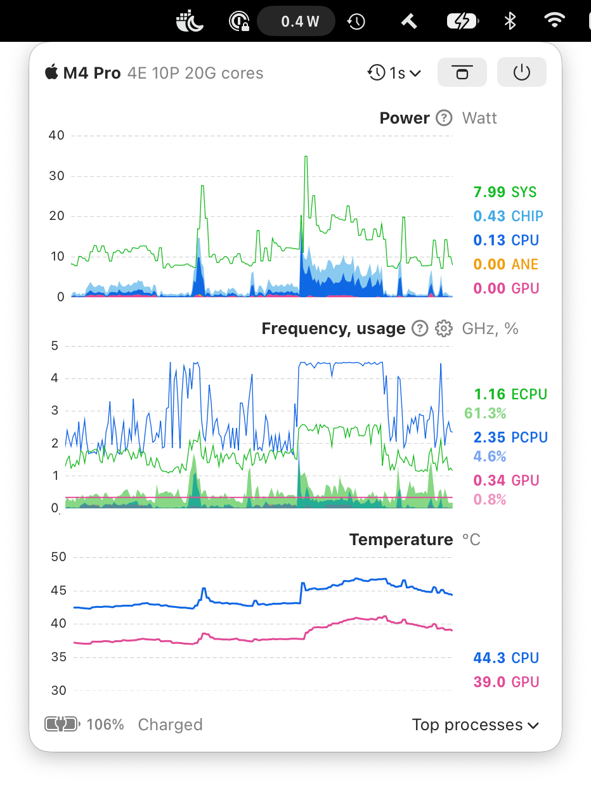

# StillCore LTR

**LTR stands for Long Term Report.** This is the long term reporting build of
StillCore: it keeps everything the original does and adds recorded history, so
you can look back at power use over a day, a month, a quarter or a year instead
of only at the last few minutes. See [History and Reports](#history-and-reports).

StillCore is built for continuous Apple Silicon monitoring with low overhead. It stays in the macOS menu bar, quietly tracks what the Mac is doing, and is ready when something suddenly feels off: the laptop gets warm, battery drain jumps, or a background task briefly spikes power usage.

Main features:

- Full-system power chart (including display, speakers, and peripherals). Useful when a 5 W CPU increase turns into a 10 W system increase.
- Chip, CPU and GPU power charts for more precise diagnostics.
- CPU and GPU frequency and usage on the combined chart.
- Temperature charts.
- Adjustable update interval from 100 ms to 10 seconds.
- Quick menu bar access with an optional always-open window.
- Battery session tracking, such as 15% used over 2 hours since the last charge.
- Recorded history with consumption reports by day, month, quarter and year, with tables, charts, printing and PDF or CSV export.



StillCore is for everyday monitoring rather than deep profiling. It is built on top of [macmon](https://github.com/vladkens/macmon), which provides the core Apple Silicon metrics.


## History and Reports

StillCore records what it measures so you can look back at it later.

Open **Reports...** from the menu bar icon, or press `Cmd-R`. Pick a day, month,
quarter or year, then step through periods with the arrows. Each report shows:

- Energy in watt-hours, split into CPU, GPU, ANE, the rest of the chip, and
  everything outside it.
- Average and peak system power.
- Average CPU and GPU utilisation and temperature.
- Battery discharge and how long the Mac ran unplugged.
- Coverage, that is how much of the period was actually recorded.

Use **Print** for paper or a system PDF, **PDF** to export the same pages to a
file, or **CSV** to get every figure for a spreadsheet.

### How recording works

Two processes write the history, and neither needs the other:

- The app records at its current update interval while it runs.
- The battery helper records once every 30 seconds while the app is closed, so
  a report does not go blank when you quit StillCore.

Measurements are stored in one minute buckets and rolled up into hours. Minute
buckets are kept for 14 days and hour buckets for five years, which comes to a
few megabytes per year. The database lives next to the battery tracker state:

```
~/Library/Application Support/com.github.homm.StillCore/metrics-history.sqlite
```

Recording can be turned off, and the history deleted, at the bottom of the
report window.


## Requirements

- macOS 14 or newer
- Apple Silicon Mac


## Download

Prebuilt downloads are available on the GitHub releases page:
https://github.com/GregoryPletnev/StillCoreLTR/releases

StillCore LTR is a fork of [homm/StillCore](https://github.com/homm/StillCore).
Releases of the original are published separately, on its own releases page.


## License

StillCore is released under the MIT License. The metrics core is built on
[macmon](https://github.com/vladkens/macmon), which is also distributed under
the MIT License.


## Why I Built It

I often work on a laptop and want to understand what is happening with energy usage. I used MX Power Gadget for this, but later found that it reports misleadingly low power for itself while consuming a lot of CPU power in practice[^mx-power-gadget]. That led me through several monitoring experiments, and eventually to the decision that I could build something better for my own workflow.

During development, I paid attention to StillCore's own footprint. The table below shows power usage while running different monitoring apps as `CHIP`: `CPU` + `GPU` in watts. For example, the idle baseline without any monitoring apps is `0.02`: `0.00` + `0.00`.

| App | Mode | 100ms update interval | 1 sec update interval |
| --- | --- | --- | --- |
| | | `CHIP`: `CPU` + `GPU` | `CHIP`: `CPU` + `GPU` |
| **StillCore** | In tray<br>Interactive | `0.03`: `0.01` + `0.00`<br>`0.12`: `0.03` + `0.02` | `0.02`: `0.01` + `0.00`<br>`0.04`: `0.02` + `0.00` |
| **Stats** 2.12.12 | In tray<br>Interactive | -<br>- | `0.04`: `0.01` + `0.00`<br>`0.06`: `0.02` + `0.00` |
| **iStat Menus** 7.2 | In tray<br>Interactive | -<br>- | `0.02`: `0.00` + `0.00`<br>`0.03`: `0.01` + `0.00` |
| **Activity Monitor** macOS 15.7.5 | In tray<br>Interactive | -<br>- | `0.12`: `0.09` + `0.00`<br>`0.16`: `0.12` + `0.00` |
| **MX Power Gadget** 1.6.4[^mx-power-gadget] | In tray<br>Interactive | -<br>- | `2.78`: `2.67` + `0.00`<br>`2.80`: `2.68` + `0.00` |

[^mx-power-gadget]: MX Power Gadget uses `powermetrics` for its measurements, but according to this [Habr article in Russian](https://habr.com/ru/articles/858736/), it starts a new `powermetrics` process for each sample. Because `powermetrics` has a relatively expensive startup phase, the utility can consume a few watts in practice even when its own charts show near-zero power.


## Build From Source

Building from source requires Xcode with Swift 6 support and network access for Swift Package dependencies.

Create a local DMG from source:

```sh
make dmg
```

This creates the Release `StillCore.dmg`.

Remove build artifacts:

```sh
make clean
```


## Development

Development builds use `CONFIGURATION=Debug` by default.
Pass `CONFIGURATION=Release` to build and run the Release configuration with the same command.

Install repository-managed Git hooks once per checkout:

```sh
make install-hooks
```

Build and run from the terminal:

```sh
make run
```

Build and open the app bundle:

```sh
make open-app
```

Rebuild the app and restart the battery helper if it is already registered:

```sh
make helper-restart
```

Launch Instruments Time Profiler for a Release build:

```sh
make profile
```


## Local Metrics Core Development

Use `LOCAL=1` when you want to develop or test StillCore together
with local changes in the metrics collection core.

Additional requirements:

- Rust toolchain with Cargo
- Xcode command line tools
- Local checkouts of `macmon` and `macmon-bindings` next to this repository

Clone the sibling repositories and build the local `macmon` xcframework:

```sh
cd ..
git clone https://github.com/homm/macmon.git
git clone https://github.com/homm/macmon-bindings.git
cd macmon
make xcframework
cd ../StillCore
```

Build and open StillCore against the local metrics core:

```sh
LOCAL=1 make open-app
```

`LOCAL=1` uses `StillCore.local.xcworkspace`, expects `../macmon/dist/CMacmon.xcframework`,
and uses the sibling `../macmon-bindings` checkout.
