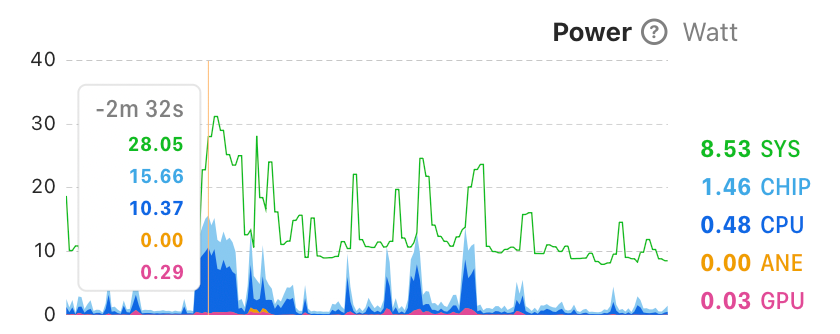

# StillCore LTR

**Long term power reports for Apple Silicon Macs.**

StillCore LTR lives in the macOS menu bar and shows what your Mac is doing right
now: power, frequency, usage, temperature, top processes and battery. It also
**records** these metrics, so you can look back at a day, a month, a quarter or a
year and see how much energy the Mac actually used. LTR stands for
*Long Term Report*.

The app is built for continuous monitoring with low overhead, not for deep
profiling. The metrics core is [macmon](https://github.com/vladkens/macmon).

<p align="center">

</p>


## Download

Get `StillCoreLTR.dmg` from the
[releases page](https://github.com/GregoryPletnev/StillCoreLTR/releases/latest).

Requires an Apple Silicon Mac with macOS 14 or newer. The app has no automatic
updates, so check the releases page for new versions.

If a release is not notarized, macOS refuses to open it the first time. Copy
`StillCoreLTR.app` to Applications, then run once:

```sh
xattr -dr com.apple.quarantine /Applications/StillCoreLTR.app
```


## Features

- **Long term reports** by day, month, quarter and year, with tables, charts,
  printing and PDF or CSV export. See [Reports](#reports).
- **History recording** that continues while the app is closed.
- System and chip power with stacked CPU, GPU and Neural Engine readings.
- CPU and GPU frequency and usage on one combined chart.
- Temperature charts.
- Top processes by CPU, GPU, memory or CPU power. Quit a process or limit its
  power use.
- Update interval from 100 ms to 10 seconds.
- Menu bar metrics of your choice, a battery icon or percentage, and an optional
  floating window.
- Battery drain tracking with awake and asleep time since unplugging, and
  detailed charge statistics.
- Automatic and Power Save modes for the current power source.


## Reports

Open **Reports...** from the menu bar icon, the toolbar button, or press `Cmd-R`.
Select a day, month, quarter or year, then use the arrows to step between
periods. Each report shows:

- Energy in watt-hours: CPU, GPU, Neural Engine, the rest of the chip, and
  everything outside the chip.
- Average and peak system power.
- Average CPU and GPU usage and temperature.
- Battery discharge and time on battery.
- Coverage: how much of the period was actually recorded.

Use **Print** for paper or a system PDF, **PDF** to export the same pages to a
file, or **CSV** to get every figure for a spreadsheet.

### How recording works

Two processes write the history. Each one works without the other:

- The app records at its update interval while it runs.
- The battery helper records every 30 seconds while the app is closed, so a
  report has data even after you quit the app.

Data is stored in one-minute buckets, which roll up into hours. Minute buckets
are kept for 14 days and hour buckets for five years. This is a few megabytes
per year. The database is at:

```
~/Library/Application Support/com.ftech.StillCoreLTR/metrics-history.sqlite
```

To stop recording or delete the history, use the controls at the bottom of the
report window.


## Live monitoring



### Power and activity

Compare total system power with chip power and see how much the CPU, GPU and
Neural Engine contribute. Put the chart marker on a spike to see what happened
at that moment.

<br clear="all">


### Top processes

Sort processes by CPU usage, GPU usage, memory or CPU power. Filter by
application, process name or PID. Quit a process or apply a background policy
from the list.

<br clear="all">


### Battery charge and drain

See the remaining charge and how much you used since you unplugged. The battery
popover also shows how long the Mac was awake and asleep in that session.

macOS can show 100% when the battery is below full capacity. StillCore LTR can
show charge above that threshold, so you see it drop after you unplug while
macOS still shows 100%.

<br clear="all">


### Menu bar and floating window

Select the metrics that the menu bar shows. Detach the main window to keep the
charts visible while you work.

<br clear="all">


## What is different in LTR

StillCore LTR is based on the open source StillCore app. It keeps all of its
live monitoring features and changes the following:

| | StillCore LTR |
|---|---|
| **Added** | Recorded history, long term reports, print, PDF and CSV export, recording controls |
| **Removed** | Automatic updates (Sparkle). New versions come from the releases page only |
| **Changed** | App name `StillCoreLTR.app`, bundle id `com.ftech.StillCoreLTR`, own helpers, settings and data. LTR can be installed next to the original app |
| **Changed** | The chip summary reads `8P+2E CPU · 16-core GPU` |
| **Versions** | Own version line, starting at 1.0.0. Release tags are `ltr-v<version>` |

For the full list, including every changed file and how to merge new versions of
the base app, see [docs/FORK.md](docs/FORK.md). Release history is in
[CHANGELOG.md](CHANGELOG.md).


## Development

You need Xcode with Swift 6 support and network access for Swift Package
dependencies. Run `make help` to see all commands.

```sh
make app          # build StillCoreLTR.app (Debug)
make run          # build and run in the current terminal
make open-app     # build and open the app bundle
make test         # build the app and run automated checks without root
make dmg          # build a Release StillCoreLTR.dmg
make dmg ADHOC=1  # the same, signed ad-hoc (no certificate needed)
make profile      # profile a Release build with Instruments Time Profiler
make clean        # remove .build
```

Install the repository Git hooks once per checkout:

```sh
make install-hooks
```

Releases are published from tags by GitHub Actions. See
[docs/RELEASING.md](docs/RELEASING.md).

### Local metrics core

Use `LOCAL=1` to build against local changes to `macmon`. You need a Rust
toolchain with Cargo, and checkouts of `macmon` and `macmon-bindings` next to
this repository:

```sh
pushd ..
git clone https://github.com/homm/macmon.git
git clone https://github.com/homm/macmon-bindings.git
make -C macmon xcframework
popd

make open-app LOCAL=1
```

`LOCAL=1` uses `StillCore.local.xcworkspace`, expects
`../macmon/dist/CMacmon.xcframework`, and uses the sibling `../macmon-bindings`
checkout.


## License

MIT, see [LICENSE](LICENSE). StillCore LTR is based on StillCore by Aleksandr
Karpinskii, also MIT licensed. The metrics core is
[macmon](https://github.com/vladkens/macmon). Sensor tables are adapted from
[Stats](https://github.com/exelban/stats). `StillCoreLTR.app` includes the
license notices for [macmon](Licenses/macmon.txt), [Stats](Licenses/Stats.txt)
and [DGCharts](Licenses/DGCharts.txt).
